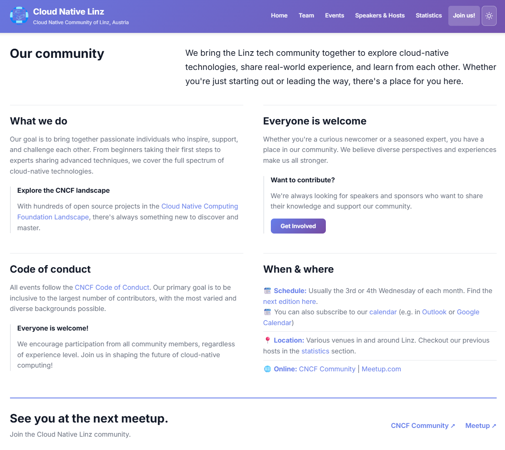

# Cloud Native Linz Website

[](https://github.com/cloudnativelinz/cloudnativelinz.github.io/commits/main)
[](https://cloudnativelinz.github.io)
[](https://github.com/cloudnativelinz/cloudnativelinz.github.io/graphs/contributors)
[](https://github.com/CloudNativeLinz/cloudnativelinz.github.io/actions/workflows/dependabot/dependabot-updates)

Official website for the Cloud Native Linz community.

🌐 Website: https://cloudnativelinz.at

📅 Meetup page: https://www.meetup.com/Cloud-Native-Linz/

💬 Community page: https://ocgroups.dev/cncf/group/cloud-native-linz

## Homepage Preview



## Quick Start

This site is built with Jekyll.

### Recommended: Dev Container or Codespaces

The easiest setup is GitHub Codespaces or VS Code Dev Containers, where tooling is preconfigured.

Run locally:

```bash
bundle install
bundle exec jekyll serve --livereload
```

Open preview at: http://127.0.0.1:4000

If file watching is unreliable on your machine (commonly Windows), use:

```bash
bundle exec jekyll serve --livereload --force_polling
```

## Makefile Commands

This repository includes common shortcuts in [`makefile`](makefile):

- `install`: Install Ruby dependencies and run a build
- `build`: Run a strict production build
- `lint`: Check Python, YAML, and Ruby sources
- `test`: Run Python tests, generate the calendar, and run a production build
- `check`: Run all lint and test checks
- `serve`: Run Jekyll server on all interfaces
- `serve-livereload`: Run server with live reload
- `serve-windows`: Live reload with force polling
- `clean`: Remove build and cache artifacts
- `calendar`: Generate `calendar.ics` from event data

Examples:

```bash
make install
make check
make serve-livereload
make calendar
```

## Content and Data

Key locations:

- Pages: [`_pages`](./_pages)
- Layouts: [`_layouts`](./_layouts)
- Includes: [`_includes`](./_includes)
- Styles: [`assets/style.scss`](assets/style.scss)
- Event data: [`_data/events.yml`](_data/events.yml)
- Event banners: [`images/events`](images/events)

Talk entries in `_data/events.yml` can include an optional `bio` field.
Non-empty biographies appear below the talk abstract on the event page and support Markdown.

Confirmed speakers appear on the homepage and event page even when their talk
title is blank, `TBA`, or `TBD`. Entries with a blank, `TBA`, or `TBD` speaker
name remain hidden.

The sticky header and expanded mobile/tablet menu use a translucent brand
gradient with backdrop blur so content shows softly behind them. Browsers without
backdrop-filter support, or users who prefer reduced transparency, get the solid
gradient.

### Event Artwork

Store event banners in `images/events/` as `<id>.jpg`, using the numeric `id`
from `_data/events.yml`. For example, event `51` uses `images/events/51.jpg`.
Keep filenames lowercase and use the `.jpg` extension. No additional image
field is needed in the event data.

Upcoming event cards use `<id>-teaser.jpg` when present, then `<id>.jpg`.
Event detail pages prefer `<id>.jpg`, then `<id>-teaser.jpg`; both retain the
existing placeholders when artwork is missing. Separate `-550.jpg` thumbnails
are not required.

Add new banners directly to `images/events/`, not the generated `_site/`
directory. Jekyll copies them to the built site automatically. Speaker photos
are separate from these event banners.

On each `main` deployment, the workflow compares `_data/events.yml` with the
last successfully processed version. It generates both the details image
`<id>.jpg` and teaser `<id>-teaser.jpg` for changed or new upcoming events,
then builds the site with those files in the same run. Unchanged and past
events are not regenerated. By default regenerated images replace existing
artwork; add `generate_images: false` to an event to preserve custom artwork
and opt it out of automatic generation.

The workflow commits generated files and its event-data baseline to `main` as
`github-actions[bot]`. The bot commit does not trigger another workflow; its
images are already part of that run's Pages artifact. Manual runs should be
started on `main`. A no-op event-data comparison does not create a commit.

The generator is installed from the pinned
[asset-generator commit](https://github.com/CloudNativeLinz/asset-generator/tree/d03d1db1220365986d550ebd22898c83cd535894).
The upstream change is currently tracked by
[asset-generator#40](https://github.com/CloudNativeLinz/asset-generator/pull/40);
that PR must be merged and the pinned commit kept reachable before merging or
deploying this website change. Update the full commit pin deliberately when
upgrading the generator.

Automatic commits require the repository's standard `GITHUB_TOKEN` to have
`contents: write` and for branch protection/rulesets to permit that token to
push to `main`. No user secret or repository-setting change is required by
this workflow. If protection blocks the push, the Pages run fails without
advancing its baseline or deploying stale output. Review the Actions log,
allow the bot push under the existing policy, and rerun the workflow on
`main`. Missing or invalid baseline objects also fail explicitly; restore a
valid `.github/event-images-baseline` before rerunning rather than replacing it
with the current event-data hash, which could skip pending image changes.

## Event URL Redirects

Event pages use stable slugs to avoid broken links when titles change.

- Guide: [`REDIRECT_MANAGEMENT.md`](REDIRECT_MANAGEMENT.md)
- Helper script: [`manage_redirects.rb`](manage_redirects.rb)
- Redirect generator plugin: [`_plugins/datapage_redirect_generator.rb`](_plugins/datapage_redirect_generator.rb)

Typical workflow:

```bash
ruby manage_redirects.rb
bundle exec jekyll build
```

## Calendar Generation

The repository can generate `calendar.ics` from event data.

- Script: [`generate_calendar.py`](generate_calendar.py)
- Python deps: [`requirements.txt`](requirements.txt)

Run via Makefile:

```bash
make calendar
```

## Build and Deploy

GitHub Pages builds and serves this site from this repository.

CI explicitly runs `make calendar` before validation and the site build, so
calendar updates do not depend on regenerating or committing the file locally.
`make check` also regenerates it for local builds.

To validate locally before pushing:

```bash
make check
```

## Contributing

Contributions are welcome.

1. Create a branch
2. Make your changes
3. Build locally and verify
4. Open a pull request
